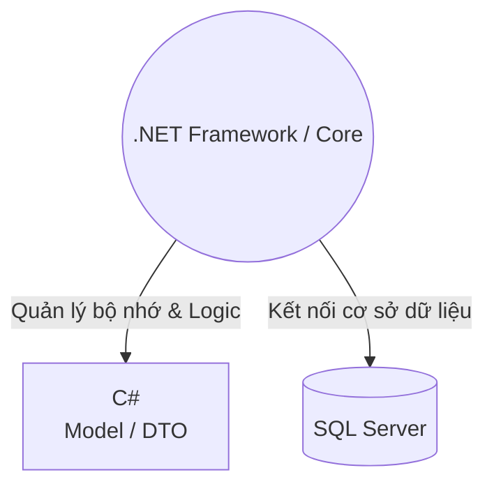
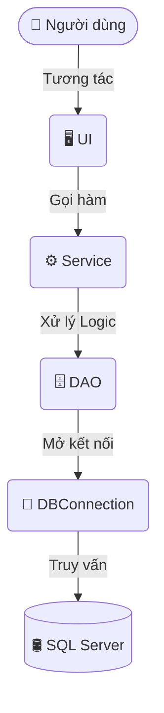

## 🎯 Vai trò của .NET trong Hệ thống

**.NET** là nền tảng cốt lõi để xây dựng các ứng dụng **C#**. 
Dù dự án sử dụng công nghệ nào:
- 🖥️️ `C# WPF` (Desktop)
- 🌐 `C# ASP.NET` (Web)
- ⚙️ `C# Web API` (Backend)

👉 Tất cả đều có thể chạy trên nền tảng **.NET**. 
Trong project, **.NET** đứng ở giữa đóng vai trò điều phối trung tâm:



---

## 🗂️ Cấu trúc phân tầng Project (HorseManagement)

Cấu trúc thư mục được chia theo chuẩn mô hình nhiều tầng (N-Tier/MVC), giúp tách biệt logic nghiệp vụ, giao diện và cơ sở dữ liệu:

```bash
🐎 HorseManagement
│
├── 📂 Models         # Chứa các class đại diện cho cấu trúc dữ liệu
│   └── 📄 HorseDTO.cs
│
├── 📂 Data           # Cấu hình và chuỗi kết nối tới Database
│   └── 📄 DBConnection.cs
│
├── 📂 DAOs           # Data Access Object - Thực thi truy vấn SQL
│   └── 📄 HorseDAO.cs
│
├── 📂 Services       # Chứa logic nghiệp vụ (Business Logic)
│   └── 📄 HorseService.cs
│
└── 📂 UI             # Giao diện người dùng
    └── 🖼️ HorsePage.xaml
```

---

## 🔄 Luồng hoạt động (Data Flow)

### 1. Luồng tổng quan (Kiến trúc hệ thống)



### 2. Ví dụ thực tế: Chức năng "Tìm ngựa"

Khi người dùng bấm nút **"Tìm ngựa"**, dữ liệu sẽ đi qua các tầng sau:

```yaml
1. 👤 Người dùng     : Bấm nút "Tìm ngựa" trên màn hình.
        ⬇️
2. 🖥️ UI             : Nhận sự kiện click, truyền từ khóa xuống tầng Service.
        ⬇️
3. ⚙️ HorseService   : Kiểm tra hợp lệ (validate), gọi hàm tìm kiếm của DAO.
        ⬇️
4. 🗄️ HorseDAO       : Dịch logic thành câu lệnh SQL.
        ⬇️
5. 🔍 SQL Query      : SELECT * FROM Horses WHERE Name LIKE '%...%'
        ⬇️
6. 🛢 SQL Server     : Thực thi truy vấn, trả về các record thô từ Database.
        ⬇️
7. 📦 HorseDTO       : Đóng gói (Map) dữ liệu thô SQL thành Object C#.
        ⬇️
8. 🖥️ UI             : Nhận danh sách List<HorseDTO> và hiển thị lên bảng (DataGrid).
```
