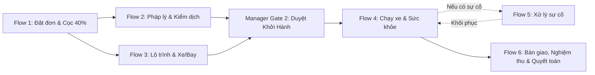

# KỊCH BẢN KIỂM THỬ TOÀN BỘ HỆ THỐNG (FLOW 1 ĐẾN FLOW 6)
**Dự án:** Racehorse Transport System (Hệ thống Quản lý Vận chuyển Ngựa đua Quốc tế)  
**Môi trường:** Local (`Frontend: http://localhost:5173` | `Backend: http://localhost:5129`)  
**Mật khẩu mặc định toàn hệ thống:** `123456` hoặc bấm nút **Quick Login** tương ứng trên màn hình Đăng nhập.

---

## 1. BẢNG TÀI KHOẢN VÀ VAI TRÒ (QUICK LOGIN)

| Vai trò (Role) | Email Đăng nhập | Trách nhiệm chính trong hệ thống |
| :--- | :--- | :--- |
| **CUSTOMER** (Khách hàng 1) | `vana.horse@gmail.com` | Đặt đơn, xem hợp đồng, ký OTP, thanh toán cọc/số dư VNPay, theo dõi hành trình, nghiệm thu |
| **CUSTOMER** (Khách hàng 2) | `tranb.racing@gmail.com` | Khách hàng phụ kiểm thử song song |
| **LOGISTICS_MANAGER** (Quản lý) | `linh.manager@cbntransport.com` | Soạn & phát hành hợp đồng, duyệt phân công nhân sự, duyệt kế hoạch lộ trình, duyệt Gate 2 khởi hành, duyệt sự cố, đóng đơn |
| **TRANSPORT_SPECIALIST** (Chuyên viên) | `tuan.specialist@cbntransport.com` | Thẩm định hồ sơ pháp lý, giấy kiểm dịch, vắc-xin, hộ chiếu FEI từng ngựa (Flow 2) |
| **FLEET_ROUTE_COORDINATOR** (Điều phối) | `hai.coord@cbntransport.com` | Lập trạm dừng nghỉ, gán xe/tài xế/bác sĩ, đặt chuyến bay Charter, lập phương án xử lý sự cố (Flow 3, Flow 5) |
| **DRIVER_ESCORT** (Tài xế chính VN) | `hung.driver@cbntransport.com` | Kiểm tra xe/ngựa, xuất phát, check-in mốc hành trình, ghi nhật ký y tế, báo sự cố, bàn giao ngựa (Flow 4, Flow 5, Flow 6) |
| **DRIVER_ESCORT** (Bác sĩ thú y) | `hoa.escort@cbntransport.com` | Bác sĩ áp tải ghi chép sức khỏe ngựa (Flow 4) |
| **DRIVER_ESCORT** (Tài xế quốc tế JP) | `kenji.driver@cbntransport.jp` | Tài xế chặng nội địa Nhật Bản đón ngựa từ sân bay Narita về trường đua (Flow 4, Flow 6) |

---

## 2. KỊCH BẢN CHI TIẾT TỪNG FLOW

---

### 📌 FLOW 1: TẠO ĐƠN, SOẠN HỢP ĐỒNG & THANH TOÁN CỌC (40%)

#### Bước 1.1: Khách hàng tạo yêu cầu vận chuyển
1. **Đăng nhập:** Quick login `vana.horse@gmail.com` (Khách hàng).
2. **Truy cập:** Menu **Tạo yêu cầu mới** (`/customer/booking` hoặc `/customer/requests/new`).
3. **Thao tác:**
   - **Lịch vận chuyển:** Chọn ngày CBN lấy ngựa và ngày mong muốn tới nơi (cách tối thiểu 3 ngày theo quy định).
   - **01. Nơi nhận ngựa:**
     - Tên chuồng: `Trang trại Sóc Sơn`
     - Tỉnh/thành phố: `Hà Nội`
     - Địa chỉ chi tiết: `12 Nguyễn Huệ` $\rightarrow$ bấm **Tìm vị trí** $\rightarrow$ nhấp chọn 1 kết quả từ danh sách gợi ý.
     - Người bàn giao: `Nguyễn Văn A` - SĐT: `0901234567`
   - **02. Nơi giao ngựa:**
     - Tên chuồng: `Trường đua Phú Thọ`
     - Tỉnh/thành phố: `TP. Hồ Chí Minh`
     - Địa chỉ chi tiết: `1199 Lê Đức Thọ` $\rightarrow$ bấm **Tìm vị trí** $\rightarrow$ nhấp chọn 1 kết quả gợi ý.
     - Người nhận: `Trần Văn B` - SĐT: `0909888999`
   - Bấm **Lưu & tiếp tục: Ngựa & hồ sơ →**.
   - **Khai báo ngựa:** Chọn hoặc thêm mới ngựa (Tên: `Tia Chớp Đỏ`, Giống: `Thoroughbred`, Số microchip: `985141001234567`, Hộ chiếu: `FEI-VN-2026`).
   - Bấm **Gửi yêu cầu xét duyệt**.
4. **Kết quả mong đợi:** Yêu cầu được tạo với trạng thái `PENDING_REVIEW` (hoặc `SUBMITTED`), mã đơn dạng `REQ_xxxx`.

#### Bước 1.2: Quản lý thẩm định và phát hành hợp đồng
1. **Đăng nhập:** Quick login `linh.manager@cbntransport.com` (Manager).
2. **Truy cập:** Menu **Yêu cầu cần xử lý** (`/manager/requests`).
3. **Thao tác:**
   - Chọn đơn vừa tạo.
   - Bấm **Soạn hợp đồng** (`/manager/contracts/editor`).
   - Kiểm tra bảng tính giá 5 thành phần (Phí cơ bản, Chuẩn bị, Chăm sóc y tế, Bảo hiểm, Thuế GTGT).
   - Thiết lập tỷ lệ cọc: `40%`.
   - Bấm **Phát hành hợp đồng cho khách hàng (Publish)**.
4. **Kết quả mong đợi:** Hợp đồng chuyển sang trạng thái `ISSUED` / `AWAITING_SIGNATURE`.

#### Bước 1.3: Khách hàng ký OTP và thanh toán cọc VNPay
1. **Đăng nhập lại:** `vana.horse@gmail.com` (Khách hàng).
2. **Truy cập:** Chi tiết yêu cầu $\rightarrow$ Tab **Hợp đồng** (`/customer/contracts`).
3. **Thao tác:**
   - Đọc hợp đồng, tích chọn **Tôi đồng ý với các điều khoản vận chuyển**.
   - Bấm **Ký hợp đồng điện tử**.
   - Nhập mã OTP bypass: `000000` (hoặc lấy mã gửi về email). Bấm **Xác nhận ký**.
   - Hợp đồng chuyển sang `AWAITING_DEPOSIT`.
   - Bấm nút **Thanh toán cọc 40% qua VNPay**.
   - Tại trang Sandbox VNPay: Chọn ngân hàng `NCB`, nhập số thẻ test `9704198526171405`, tên `NGUYEN VAN A`, ngày phát hành `07/15`, OTP `123456`. Bấm xác nhận.
4. **Kết quả mong đợi:**
   - VNPay IPN phản hồi thành công $\rightarrow$ Hóa đơn cọc đổi thành `PAID`.
   - Trạng thái Request chuyển thành **`ACTIVATED`**.
   - Hệ thống tự động tạo 1 Chuyến đi (**Trip**) ở trạng thái **`PLANNING`**, tự động kích hoạt 2 nhánh song song (Flow 2 & Flow 3).

---

### 📌 FLOW 2: THẨM ĐỊNH PHÁP LÝ & KIỂM DỊCH (SPECIALIST)
*(Chạy song song độc lập với Flow 3)*

1. **Đăng nhập:** Quick login `tuan.specialist@cbntransport.com` (Chuyên viên).
2. **Truy cập:** Menu **Hồ sơ pháp lý** (`/specialist/dashboard` hoặc `/specialist/documents`).
3. **Thao tác:**
   - Mở chuyến đi vừa tạo.
   - Xem bảng checklist hồ sơ của ngựa:
     - Xét nghiệm máu Coggins (Equine Infectious Anemia).
     - Giấy chứng nhận tiêm vắc-xin Cúm ngựa (Equine Influenza).
     - Hộ chiếu FEI / Giấy chứng nhận giống.
     - Giấy chứng nhận kiểm dịch nội địa / Giấy phép xuất nhập khẩu (nếu đi Nhật Bản).
   - Lần lượt bấm **Thẩm định đạt (Verify)** cho từng tài liệu.
   - Khi tất cả tài liệu chuyển sang màu xanh (`VERIFIED`), bấm nút: **Xác nhận hoàn tất pháp lý (Confirm Documents Ready)**.
4. **Kết quả mong đợi:**
   - Thuộc tính chuyến đi cập nhật: **`DocumentsStatus = 'READY'`** (kèm thời gian xác nhận).

---

### 📌 FLOW 3: LẬP KẾ HOẠCH LỘ TRÌNH, XE/TÀI XẾ & BAY CHARTER (COORDINATOR)
*(Chạy song song độc lập với Flow 2)*

1. **Đăng nhập:** Quick login `hai.coord@cbntransport.com` (Điều phối viên).
2. **Truy cập:** Menu **Lập kế hoạch chuyến đi** (`/coordinator/trips`).
3. **Thao tác:**
   - Mở chuyến đi đang ở trạng thái `PLANNING`.
   - **Tab Lộ trình (Route Planning):**
     - Bản đồ Leaflet hiển thị tuyến đường nối điểm đi và điểm đến.
     - Thiết lập các điểm dừng nghỉ (Rest Stops): Quy tắc không lái liên tục quá 4 giờ, nghỉ ít nhất 45 phút tại trạm có nước và chuồng tạm.
     - Bấm **Lưu lộ trình**.
   - **Tab Phân công nguồn lực (Resource Assignment):**
     - Chọn Xe chuyên dụng: Xe thùng 2 chỗ `VEH_BOX_01`.
     - Phân công Kíp xe: Tài xế chính `Hoàng Hùng` (`USR_DRV_01`), Phụ lái, Bác sĩ thú y `Đỗ Hoa` (`USR_ESC_01`).
     - (Nếu là tuyến Bay Nhật Bản): Nhập hợp đồng thuê chuyến bay Charter (Hãng hàng không, Giờ bay, Mã chuồng `Jet Stall`), bố trí tổ xe đầu Nhật Bản đón tại sân bay Narita.
   - Bấm **Gửi kế hoạch lên Quản lý duyệt (Submit Plan)**.
4. **Quản lý phê duyệt kế hoạch:**
   - Đăng nhập: `linh.manager@cbntransport.com` $\rightarrow$ Vào `/manager/trips/{id}/review`.
   - Kiểm tra phương án xe, kíp lái và lộ trình. Bấm **Phê duyệt phương án vận hành (Approve Plan)**.
5. **Kết quả mong đợi:**
   - Thuộc tính chuyến đi cập nhật: **`OperationsStatus = 'READY'`** và **`RouteStatus = 'APPROVED'`**.

---

### 📌 CỔNG HỘI TỤ (MANAGER GATE 2: PHÊ DUYỆT KHỞI HÀNH)

1. **Đăng nhập:** `linh.manager@cbntransport.com` (Manager).
2. **Truy cập:** Chi tiết chuyến đi (`/manager/trips/{id}`).
3. **Kiểm tra điều kiện:**
   - Cột Hồ sơ: `DocumentsStatus = READY` (Flow 2 hoàn tất).
   - Cột Vận hành: `OperationsStatus = READY` & `RouteStatus = APPROVED` (Flow 3 hoàn tất).
   - Nút **Phê duyệt lệnh xuất phát (Approve Departure)** sáng lên.
4. **Thao tác:** Bấm **Phê duyệt lệnh xuất phát**.
5. **Kết quả mong đợi:**
   - Chuyến đi chuyển trạng thái sang **`READY_TO_DEPART`**.
   - Request chuyển thành **`SCHEDULED`**.
   - Hệ thống tự động sinh ra danh sách toàn bộ các mốc hành trình (**Milestones**) giao cho tài xế ở Flow 4.

---

### 📌 FLOW 4: VẬN HÀNH & THEO DÕI HÀNH TRÌNH (DRIVER & ESCORT)

#### Bước 4.1: Kiểm tra trước xuất phát & Bắt đầu hành trình
1. **Đăng nhập:** Quick login `hung.driver@cbntransport.com` (Tài xế).
2. **Truy cập:** Màn hình nhiệm vụ tài xế (`/driver/trip` hoặc `/driver/journey`).
3. **Thao tác:**
   - Thực hiện Checklist an toàn: Kiểm tra xe (`VEHICLE_VERIFIED`), kiểm tra thể trạng ngựa tại điểm đón (`HORSES_CHECKED`).
   - Bấm nút **Bắt đầu xuất phát (Depart)**.
4. **Kết quả mong đợi:**
   - Chuyến đi chuyển trạng thái thành **`IN_TRANSIT`** (Hệ thống tự động khóa chặt, không cho sửa kế hoạch lộ trình ở Flow 3 nữa).

#### Bước 4.2: Check-in các mốc hành trình & Ghi nhật ký sức khỏe
1. Tại màn hình hành trình của Tài xế:
   - Danh sách mốc hiển thị theo thứ tự (`PICKUP` $\rightarrow$ `REST_STOP` $\rightarrow$ `DESTINATION`).
   - Đến trạm nghỉ: Bấm **Check-in mốc đến trạm** (`STOP_ARRIVED`).
   - Tại trạm có yêu cầu kiểm tra y tế (`requiresHealthCheck: true`):
     - Bác sĩ/Tài xế mở mục **Nhật ký sức khỏe (Health Log)**.
     - Nhập sinh hiệu: Thân nhiệt `37.8°C`, Nhịp tim `38 bpm`, Tình trạng nước uống `Đã uống 15 lít`, Thể trạng `Bình thường (NORMAL)`. Bấm **Lưu nhật ký**.
     - Khi đã có nhật ký sức khỏe, nút **Rời trạm** (`STOP_DEPARTED`) mới được mở khóa.
2. **Khách hàng & Quản lý giám sát thời gian thực:**
   - Mở màn hình `/customer/tracking/{tripId}` và `/manager/monitoring`.
   - Thấy vị trí xe cập nhật, mốc trạm chuyển xanh, nhật ký sức khỏe hiển thị trực quan.

#### Bước 4.3: Đến đích giao ngựa
1. Xe đến địa chỉ giao ngựa cuối cùng.
2. Tài xế bấm: **Ghi nhận đã đến điểm giao (Final Arrived)**.
3. **Kết quả mong đợi:** Mốc `FINAL_ARRIVED` hoàn tất, kết thúc Flow 4, tự động mở thủ tục Bàn giao của Flow 6.

---

### 📌 FLOW 5: XỬ LÝ SỰ CỐ TRÊN ĐƯỜNG (INCIDENT MANAGEMENT)
*(Chỉ kích hoạt khi có sự cố bất thường — Kịch bản kiểm thử tình huống ngoại lệ)*

1. **Tài xế báo sự cố:**
   - Tại màn hình tài xế khi xe đang `IN_TRANSIT`, bấm nút **Báo cáo sự cố khẩn cấp (Report Incident)**.
   - Chọn loại sự cố: `VEHICLE_RESOURCE` (Xe hỏng/nổ lốp) hoặc `HORSE_HEALTH` (Ngựa đau bụng/sốt).
   - Mô tả: `Xe bị sự cố nổ lốp sau bên phụ tại Km 125, cần xe cứu hộ`.
   - Bấm **Gửi báo cáo sự cố**.
   - *Kết quả:* Chuyến đi tự động bị kích hoạt **Safety Blocker**, khóa không cho check-in đi tiếp.
2. **Điều phối viên lập phương án khôi phục:**
   - Đăng nhập `hai.coord@cbntransport.com` $\rightarrow$ Vào `/coordinator/incidents`.
   - Mở sự cố vừa báo. Đánh giá ảnh hưởng thời gian và chi phí nội bộ.
   - Lập phương án: `Điều xe cứu hộ VEH_BOX_02 đến thay thế`.
   - **Xác nhận chi phí khách hàng:** `Phụ phí khách hàng = 0 VNĐ` (Quy tắc CBN chịu 100% rủi ro sự cố).
   - Bấm **Trình Quản lý duyệt phương án**.
3. **Quản lý phê duyệt phương án:**
   - Đăng nhập `linh.manager@cbntransport.com` $\rightarrow$ Vào `/manager/incidents`.
   - Bấm **Phê duyệt phương án xử lý**.
4. **Đóng sự cố và tiếp tục hành trình:**
   - Điều phối viên xác nhận xe cứu hộ đã hoàn tất công việc, kiểm tra ngựa an toàn.
   - Bấm **Đóng sự cố (Resolve Incident)**.
   - *Kết quả:* Safety Blocker được giải phóng, tài xế quay lại màn hình Flow 4 tiếp tục hành trình.

---

### 📌 FLOW 6: BÀN GIAO, NGHIỆM THU, THANH TOÁN SỐ DƯ (60%) & ĐÓNG ĐƠN

#### Bước 6.1: Biên bản bàn giao tại điểm đến (Handover)
1. **Đăng nhập:** `hung.driver@cbntransport.com` (Tài xế).
2. **Truy cập:** Màn hình Bàn giao (`/driver/handover` hoặc `/driver/trip-detail/{id}`).
3. **Thao tác:**
   - Quét/nhập mã Microchip đối chiếu từng cá thể ngựa.
   - Đánh giá thể trạng: `Khỏe mạnh, nguyên vẹn`.
   - Bàn giao phụ kiện: Yên cương, chăn đắp, sổ theo dõi y tế.
   - Cho người nhận ngựa ký tên xác nhận điện tử.
   - Bấm **Hoàn tất bàn giao (Complete Handover)**.
4. **Kết quả mong đợi:**
   - Chuyến đi chuyển thành **`COMPLETED`**.
   - Yêu cầu vận chuyển chuyển thành **`DELIVERED`**.
   - Xe và nhân sự được giải phóng trạng thái về `AVAILABLE`.

#### Bước 6.2: Khách hàng nghiệm thu dịch vụ
1. **Đăng nhập:** `vana.horse@gmail.com` (Khách hàng).
2. **Truy cập:** Chi tiết đơn hàng $\rightarrow$ Tab **Bàn giao & Nghiệm thu** (`/customer/requests/{id}`).
3. **Thao tác:**
   - Xem biên bản bàn giao và ảnh chụp thực tế của ngựa.
   - (Trường hợp bình thường): Bấm **Xác nhận Nghiệm thu dịch vụ (Accept)**.
   - *(Trường hợp có khiếu nại): Mở tab Khiếu nại (Complaints) để gửi yêu cầu bồi hoàn nếu ngựa có vết thương.*
4. **Kết quả mong đợi:** Trạng thái nghiệm thu đổi thành `ACCEPTED`.

#### Bước 6.3: Thanh toán số dư 60%
1. Khách hàng bấm **Thanh toán số dư còn lại (60%) qua VNPay**.
2. Thực hiện thanh toán trên cổng Sandbox VNPay tương tự Flow 1.
3. **Kết quả mong đợi:** Hóa đơn cuối chuyển sang `PAID`, hợp đồng hoàn tất 100% nghĩa vụ tài chính (`PAYMENT_COMPLETED`).

#### Bước 6.4: Quản lý đối soát và đóng đơn (Close Request)
1. **Đăng nhập:** `linh.manager@cbntransport.com` (Manager).
2. **Truy cập:** Màn hình Quản lý đơn hàng $\rightarrow$ Tab **Đóng đơn (Closure Section)**.
3. **Thao tác:**
   - Hệ thống tự động kiểm tra đủ điều kiện:
     - `Trip: COMPLETED`
     - `Handover: CONFIRMED`
     - `Acceptance: ACCEPTED`
     - `Balance: PAID (100%)`
     - `Complaints: RESOLVED (hoặc không có)`
   - Nút **Đóng đơn vận chuyển (Close Request)** sáng lên.
   - Bấm **Xác nhận đóng đơn**.
4. **Kết quả mong đợi:**
   - Request chuyển thành **`CLOSED`**.
   - Contract chuyển thành **`CLOSED`**.
   - Toàn bộ hồ sơ được lưu trữ lịch sử hoàn tất.

---

## 3. CHECKLIST KIỂM THỬ TỔNG HỢP CHO TESTER / DEV

| Flow | Tiêu chí cốt lõi cần đạt | Điểm cần chú ý tránh lỗi |
| :--- | :--- | :--- |
| **Flow 1** | Tạo đơn thành công $\rightarrow$ Soạn HĐ $\rightarrow$ Ký OTP $\rightarrow$ Cọc 40% VNPay | Phải chọn địa chỉ chi tiết từ danh sách gợi ý để có tọa độ thật |
| **Flow 2** | Thẩm định 100% tài liệu đạt $\rightarrow$ `DocumentsStatus = READY` | Không phụ thuộc vào tiến độ của Flow 3 |
| **Flow 3** | Vẽ tuyến có trạm dừng $\rightarrow$ Gán đủ xe & 3 nhân sự $\rightarrow$ Manager duyệt $\rightarrow$ `OperationsStatus = READY` | Không lái liên tục quá 4h; Air cần đủ 2 tổ xe 2 đầu |
| **Gate 2** | Nút "Duyệt xuất phát" chỉ sáng khi CẢ Docs và Ops đều READY | Chuyển Trip sang `READY_TO_DEPART` và sinh Milestones |
| **Flow 4** | Xuất phát $\rightarrow$ `IN_TRANSIT` $\rightarrow$ Check-in trạm $\rightarrow$ Ghi log y tế $\rightarrow$ `FINAL_ARRIVED` | Trạm y tế bắt buộc ghi log sinh hiệu mới được rời trạm |
| **Flow 5** | Báo sự cố tạo Blocker dừng xe $\rightarrow$ Lập & duyệt phương án $\rightarrow$ Giải phóng Blocker | Phí sự cố cho khách luôn bằng 0 VNĐ |
| **Flow 6** | Ký biên bản giao $\rightarrow$ Khách bấm Nghiệm thu $\rightarrow$ Trả 60% VNPay $\rightarrow$ Manager đóng đơn `CLOSED` | Đơn chỉ đóng được khi đã thu đủ 100% tiền và khách đã bấm nghiệm thu |

