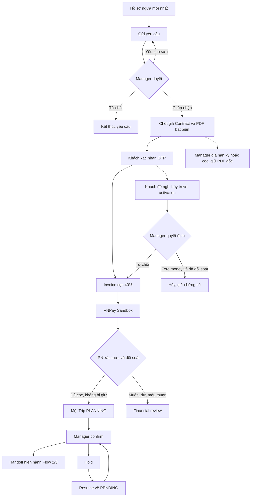

# Flow 1 — mapping cột tường minh theo scope demo mới

> Cập nhật18/10/2026: DB chính đã backup/restore-check, áp006, conversion/parity và bỏ8cột JSON theo phê duyệt trực tiếp. [Business cutover report](FLOW1_BUSINESS_CUTOVER_REPORT.md) thay trạng thái business-pending trong các mốc cũ bên dưới; chưa merge primary hoặc nghiệm thu VNPay công khai.

Chốt ngày 17/10/2026 (Asia/Saigon). **Scope này thay mapping 166 cột/005.**
Đại ca xác nhận vẫn giữ gia hạn, khách đề nghị hủy và confirm/hold/resume.
Chỉ giữ hồ sơ ngựa mới nhất, giá chốt trực tiếp trong Contract, VNPay duy nhất.
Không thêm bảng, không JSON/XML/serialized business payload, không đổi quan hệ FK.

006 là foundation additive sau 003; **không chạy 005 trước 006**. Nếu đã có 005,
script dừng để review chuyển đổi; không tự xóa các cột. 004 có thể còn tồn tại để
operator đối chiếu dữ liệu cũ; không phải fallback. Runtime DI/API/FE đã chuyển
sang typed006 ngày18/10; xem FLOW1_RELATIONAL_CUTOVER_REPORT.md và
FLOW1_RELATIONAL_OPERATOR_GUIDE.md. DB nghiệp vụ chưa006/cutover; đang có3 hồ sơ
cũ thiếu evidence trong shadow preview, không tự bypass hoặc migrate.

## Số cột và lý do

| Bảng có sẵn | Cột mới |
| --- | ---: |
| HORSE | 3 |
| TRANSPORT_REQUEST | 12 |
| CONTRACT | 26 |
| PAYMENT | 12 |
| TRIP_PLAN | 10 |
| **Tổng** | **63** |

Số này gồm 5 RowVersion do SQL tự sinh để chống stale update, không giữ timeline.
Không thêm cột vào USER, INVOICE, REQUEST_HORSE_MAPPING, COST_ITEM hoặc NOTIFICATION.
NOTIFICATION chỉ thêm index, tiếp tục là thông báo thật; không giấu workflow vào Message.
Giữ nguyên tên cột đại ca đề xuất. Các cột bổ sung còn lại phục vụ ký/PDF bất biến,
hạn gốc và hạn hiện hành, quyết định hủy/bàn giao gần nhất, đối soát và retry tiền.

## HORSE

| Cột | Kiểu/null/default | Ý nghĩa |
| --- | --- | --- |
| PhotoUrl | `nvarchar(500)` NULL | Ảnh mới nhất, private file key |
| PassportScanUrl | `nvarchar(500)` NULL | Scan passport mới nhất, private file key |
| RowVersion | `rowversion` NOT NULL tự sinh | SQL tự đổi để chặn ghi đè stale; không phải JSON state/version history |

## TRANSPORT_REQUEST

| Cột | Kiểu/null/default | Ý nghĩa |
| --- | --- | --- |
| PickupLatitude | `decimal(9,6)` NULL | Tọa độ số; cặp latitude/longitude cùng có hoặc cùng trống |
| PickupLongitude | `decimal(9,6)` NULL | Tọa độ số; cặp latitude/longitude cùng có hoặc cùng trống |
| DeliveryLatitude | `decimal(9,6)` NULL | Tọa độ số; cặp latitude/longitude cùng có hoặc cùng trống |
| DeliveryLongitude | `decimal(9,6)` NULL | Tọa độ số; cặp latitude/longitude cùng có hoặc cùng trống |
| DistanceKm | `decimal(10,2)` NULL | Đường bộ thật; AIR có thể NULL, không bịa km đường bay |
| PickupContactName | `nvarchar(100)` NULL | Người bàn giao ngựa |
| PickupContactPhone | `varchar(20)` NULL | Điện thoại người bàn giao |
| ManagerNotes | `nvarchar(1000)` NULL | Lý do duyệt/từ chối/yêu cầu sửa hiện hành, không chat |
| OriginCountry | `varchar(2)` NULL | VN→VN ROAD hoặc VN→JP AIR; không đoán quốc gia từ địa chỉ |
| DestinationCountry | `varchar(2)` NULL | VN→VN ROAD hoặc VN→JP AIR; không đoán quốc gia từ địa chỉ |
| PreparationDays | `int` NULL | Mốc chuẩn bị đã chốt, không thấp hơn floor 2/3/7 ngày |
| RowVersion | `rowversion` NOT NULL tự sinh | SQL tự đổi để chặn ghi đè stale; không phải JSON state/version history |

## CONTRACT

| Cột | Kiểu/null/default | Ý nghĩa |
| --- | --- | --- |
| PdfUrl | `varchar(500)` NULL | Private PDF có sẵn trước OTP; không phải public URL |
| SignOtpHash | `varchar(255)` NULL | HMAC keyed của OTP; clear khi dùng, không lưu OTP thô |
| SignOtpExpiry | `datetime2(7)` NULL | Hết hạn challenge hiện hành, UTC |
| SignOtpFailedAttempts | `int` NOT NULL DEFAULT 0 | 0–5; không reset bằng retry hoặc gia hạn |
| DepositDeadline | `datetime2(7)` NULL | Hạn cọc hiện hành sau ký; cập nhật cùng invoice due khi gia hạn |
| DepositAmount | `decimal(12,2)` NULL | BE tính ROUND(TotalQuotedPrice × 40%,0), VND nguyên |
| PdfSha256 | `char(64)` NULL | Hash tài liệu bất biến, gắn OTP và chứng cứ ký |
| SignOtpSentAtUtc | `datetime2(7)` NULL | Reservation hiện hành/cooldown; account budget dùng notification EMAIL thật |
| SignerEmail | `varchar(255)` NULL | Email nhận OTP được chốt khi ký, không đổi khi account đổi email |
| PublishedAtUtc | `datetime2(7)` NULL | Thời điểm phát hành PDF |
| PublishedBy | `varchar(50)` NULL | Manager phát hành; actor ID, không tạo quan hệ FK mới |
| EffectiveSignDeadline | `datetime2(7)` NULL | Hạn ký gia hạn; CompletionDeadline gốc giữ nguyên |
| SignedDepositDeadline | `datetime2(7)` NULL | Hạn cọc chốt lúc ký; không sửa khi gia hạn |
| LastExtensionTarget | `varchar(10)` NULL | SIGN hoặc DEPOSIT, chỉ lần gia hạn gần nhất |
| LastExtensionReason | `nvarchar(1000)` NULL | Lý do gia hạn gần nhất |
| LastExtensionBy | `varchar(50)` NULL | Manager gia hạn gần nhất |
| LastExtensionAtUtc | `datetime2(7)` NULL | Thời điểm gia hạn gần nhất |
| CancellationId | `varchar(50)` NULL | ID đề nghị gần nhất; decision cũ không áp vào đề nghị mới |
| CancellationStatus | `varchar(12)` NULL | PENDING/APPROVED/REJECTED; NULL khi chưa đề nghị |
| CancellationReason | `nvarchar(1000)` NULL | Lý do khách đề nghị hủy gần nhất |
| CancellationRequestedAtUtc | `datetime2(7)` NULL | Thời điểm đề nghị gần nhất |
| CancellationDecisionReason | `nvarchar(1000)` NULL | Lý do quyết định gần nhất |
| CancellationDecidedBy | `varchar(50)` NULL | Manager quyết định gần nhất |
| CancellationDecidedAtUtc | `datetime2(7)` NULL | Thời điểm quyết định gần nhất |
| IsCurrent | `bit` NOT NULL DEFAULT 0 | Một Contract hiện hành/request; legacy không tự đánh dấu đã chuyển đổi |
| RowVersion | `rowversion` NOT NULL tự sinh | SQL tự đổi để chặn ghi đè stale; không phải JSON state/version history |

## PAYMENT

| Cột | Kiểu/null/default | Ý nghĩa |
| --- | --- | --- |
| VnpayBankCode | `varchar(50)` NULL | Ngân hàng từ callback đã xác thực |
| VnpayResponseCode | `varchar(10)` NULL | ResponseCode từ callback đã xác thực |
| VnpayTransactionStatus | `varchar(10)` NULL | Chỉ SUCCESS khi cả response và transaction status là 00 |
| VnpayTmnCode | `varchar(8)` NULL | Merchant gắn với attempt lúc tạo URL |
| VnpayCreatedAtUtc | `datetime2(7)` NULL | Thời điểm tạo attempt, không dùng PaymentDate cho hai ý nghĩa |
| VnpayExpiresAtUtc | `datetime2(7)` NULL | Expiry gốc của attempt; callback đến muộn vẫn phải đối soát |
| VnpayReceivedAmount | `decimal(12,2)` NULL | Số tiền trên callback có chữ ký; khác Amount kỳ vọng phải review, không tự cấp cọc |
| FinancialReviewRequired | `bit` NOT NULL DEFAULT 0 | Giữ activation/deployment khi có tiền muộn/dư/mâu thuẫn |
| FinancialReviewReason | `nvarchar(1000)` NULL | Tình huống/ghi chú đối soát hiện hành |
| FinancialReviewedBy | `varchar(50)` NULL | Manager xác nhận xử lý đối soát gần nhất |
| FinancialReviewedAtUtc | `datetime2(7)` NULL | Thời điểm xử lý đối soát gần nhất |
| RowVersion | `rowversion` NOT NULL tự sinh | SQL tự đổi để chặn ghi đè stale; không phải JSON state/version history |

## TRIP_PLAN

| Cột | Kiểu/null/default | Ý nghĩa |
| --- | --- | --- |
| DeploymentStatus | `varchar(12)` NULL | PENDING/CONFIRMED/ON_HOLD; trạng thái vận hành, không deploy phần mềm |
| DeploymentReason | `nvarchar(1000)` NULL | Lý do thao tác gần nhất |
| DeploymentBy | `varchar(50)` NULL | Manager thao tác gần nhất |
| DeploymentAtUtc | `datetime2(7)` NULL | Thời điểm thao tác gần nhất |
| HandoffEventId | `varchar(50)` NULL | ID lần confirm hiện hành; hold/resume xóa event/ack cũ |
| RoutingAcknowledgedBy | `varchar(50)` NULL | Coordinator nhận lần handoff hiện hành |
| RoutingAcknowledgedAtUtc | `datetime2(7)` NULL | Thời điểm Coordinator nhận |
| DocumentsAcknowledgedBy | `varchar(50)` NULL | Specialist nhận lần handoff hiện hành |
| DocumentsAcknowledgedAtUtc | `datetime2(7)` NULL | Thời điểm Specialist nhận |
| RowVersion | `rowversion` NOT NULL tự sinh | SQL tự đổi để chặn ghi đè stale; không phải JSON state/version history |

## Tận dụng cột hiện có, không tạo quan hệ mới

- Request: CustomerID, Departure/Destination, TransportType, ExpectedDate (khởi hành),
  CommittedDeadline (giao), DesignatedReceiverName/Phone và Status; join ngựa qua RHM.
- Contract: RequestID/CompletionDeadline từ 003, TripID nullable, CustomerID,
  ContractCode, TotalQuotedPrice, SignedAt, CurrencyCode, DepositRateStandard và status.
- Invoice: một DEPOSIT/Contract, tổng phải thu, PaidAmount, DueDate và PaymentStatus.
- Payment: PaymentID là vnp_TxnRef; InvoiceID, Method, Amount kỳ vọng, TransactionCode
  đã xác thực, Status, PaymentDate (thời điểm nhận tiền thành công). PENDING không
  được cộng PaidAmount. Giữ thời điểm tạo/expiry trong cột VNPay riêng.
- Trip: RequestID unique theo 003; distance hiện hành, Status và thông tin vận hành mới.
  Không ghi TotalQuotedPrice thành TotalCost: scope mới không có budget chi phí nội bộ.
- PDF giữ nội dung phát hành độc lập với các ô request/hồ sơ hiện hành. Download qua
  endpoint xác thực; `private/...` là định danh file, không phải URL public.

## Quy tắc ứng dụng bắt buộc khi chuyển source

CHECK/unique/index chỉ bảo vệ một phần invariants; foundation chưa làm API.
Không tuyên bố SQL đảm bảo bất biến liên bảng hoặc xác thực chữ ký provider.

1. **A1**: gửi → PENDING; Manager accept/reject/yêu cầu sửa với ManagerNotes;
   khách chỉ sửa/gửi lại khi CHANGES_REQUESTED. Bỏ Q&A/change proposal và history.
   Có Contract đã phát hành phải đóng bản chưa ký trước khi sửa; đã ký khóa terms.
2. **Giá**: estimate bên ngoài chỉ tham khảo. Manager nhập TotalQuotedPrice trực
   tiếp, không preliminary plan/budget bốn nhóm/COST_ITEM quote rows. Backend tính
   DepositAmount=ROUND(total*0.4,0), fixed 40%, VND nguyên. Prep 2/3/7 ngày, chỉ tăng.
3. **PDF/OTP**: xuất PDF trước gửi OTP, cùng hash/Contract/customer/email/expiry.
   Không sửa PDF sau ký hoặc gia hạn. SMTP nằm ngoài transaction: reserve slot,
   gửi mã từ RAM, chỉ bật HMAC khi gửi thành công và reservation vẫn hiện hành;
   crash đóng an toàn. Notification EMAIL reservations thật dùng account lock,
   rolling budget; lần lỗi vẫn tính. Không lưu/log OTP, không reset budget bằng resend.
4. **Hạn**: CompletionDeadline là hạn ký gốc; EffectiveSignDeadline là gia hạn ký.
   Sau ký, SignedDepositDeadline chốt hạn cọc (mặc định 24h, cap tại departure trừ
   PreparationDays); DepositDeadline là hạn cọc hiện hành. UI hiển thị hạn thật,
   không hứa đủ 24h khi cap ngắn hơn. Gia hạn cọc cập nhật invoice due cùng SQL tx,
   giữ SignedAt/PDF/SignedDepositDeadline. Không auto-cancel. Chỉ last extension.
5. **Khách đề nghị hủy**: trước activation, sau ký; PENDING ngăn tạo phiên mới và
   activation nhưng IPN vẫn ghi nhận tiền. Approve chỉ khi zero verified money,
   không attempt chưa đối soát, chưa Trip. Có tiền/attempt mơ hồ phải review; không
   tự refund. Reject mở lại nếu hợp lệ và xét activation một lần khi đã đủ cọc.
   Re-request tạo CancellationId mới, chỉ giữ đề nghị/quyết định gần nhất.
6. **VNPay**: tạo PAYMENT pending trước URL; số tiền/merchant/expiry từ server,
   retry cùng key/resource không tạo attempt đôi. IPN kiểm HMAC/merchant/TxnRef/
   VND amount/cả hai code 00; ReturnURL chỉ đọc. Invoice chỉ cộng verified money
   một lần. Signed callback mismatch/late/excess/conflict giữ review và evidence,
   không giả thành công/xóa tiền/activate theo ReturnURL. ReceivedAmount ghi số
   tiền callback đã xác thực, chưa đồng nghĩa được phân bổ vào invoice khi mismatch.
   Callback mâu thuẫn không ghi đè SUCCESS đã chốt; ghi current review reason và
   đối chiếu provider trước xử lý. Không lưu gateway URL có chữ ký hoặc raw payload.
7. **Trip**: request-level SQL transaction + unique RequestID/DEPOSIT invoice từ003;
   signed + đủ verified deposit, không cancel/review block mới tạo Trip đúng một lần.
8. **Confirm/hold/resume**: Manager confirm sau activation, đủ prep và không review;
   sinh HandoffEventId, Coordinator/Specialist nhận đúng event hiện hành. Hold đưa
   về ON_HOLD, xóa event/ack cũ và chặn downstream; resume về PENDING, phải confirm
   lại. Không rollback Trip đã khởi hành. Chỉ last decision/current ack, không timeline.
9. **Concurrency**: RowVersion/If-Match cho chỉnh sửa/quyết định; ID resource +
   trạng thái đích cho retry an toàn; SQL locks/unique constraints cho ký/tiền/Trip.
   Callback/ack cũ không được áp vào lần phát hành/cancel/handoff mới. Không hứa replay
   mọi key lịch sử khi đã thu gọn history. Giữ evidence ký/PAYMENT/PDF đã phát hành.

## Chuyển đổi, test và bàn giao teammate

1. Foundation006 chỉ test trên DB disposable. Không ghi HorseTransportDB, không
   startup migration, không drop004/005, không sửa primary worktree của user.
2. Dựng typed Application/Domain/Infrastructure/WebApi và FE trong worktree riêng;
   chưa nối nửa typed/nửa JSON. Trước cutover phải chạy toàn chuỗi và UAT scope mới.
3. Retire bank-proofs/manual reconciliation allocation endpoints, plan/budget,
   Q&A/version-history UI bằng source change có kiểm coverage thay thế. Payment
   financial review vẫn giữ vì IPN đến muộn/dư/mâu thuẫn không biến mất.
4. Native DB test dùng 000→003→006; coexist004 chỉ để inventory/conversion test.
   005 và tests của nó là lịch sử, không phải prerequisites của scope này.
5. Offline conversion: inventory/dry-run, exact target + reviewed fingerprint,
   đối chiếu từng Contract/PDF/hash/SignedAt/invoice/PAYMENT/Trip và last decisions.
   Không đoán dữ liệu thiếu/conflict là thành công. Cắt history không cấp quyền
   xóa evidence gốc; bảo quản nguồn cũ/private bytes và review với operator.
6. Sau typed source cutover/parity mới viết script drop JSON constraints/columns,
   chỉ chạy DB nghiệp vụ sau quyền riêng. Sau cùng gỡ SqlFlow1StateStore/interface/
   importer cũ cùng tests đã được guard tests thay thế. Không xóa trước khi có thay thế.
7. Audit SELECT* ordinal/INSERT không tên cột/bulk/DTO consumers trước merge. Nullable
   và default không đảm bảo tự động mọi code teammate tương thích; giữ các FK cũ.
8. Acceptance: latest horse files → A1 request → Manager price/PDF → OTP → invoice →
   VNPay signed callback → one Trip → confirm/hold/resume/current-event ack; gia hạn
   trước/sau ký; cancel request/reject/zero-money approve; ownership/stale/retry/rollback,
   duplicate/late/mismatch/excess callbacks. Provider Sandbox/public HTTPS IPN là gate
   riêng; callback fixture không phải provider thật. VN→JP airport→airport vẫn giữ.

