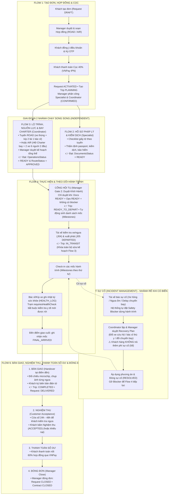

# HƯỚNG DẪN TẠO DỮ LIỆU & TÀI KHOẢN TEST TỪNG FLOW (FLOW 1 ĐẾN FLOW 6)
**Dự án:** Racehorse Transport System (Hệ thống Vận tải Ngựa đua Quốc tế)  
**Tài liệu tham chiếu chuẩn:** [CONVENTIONS.md](CONVENTIONS.md), [FLOW1.md](API-Flow/Flow1/FLOW1.md), [FLOW2.md](API-Flow/Flow2/FLOW2.md), [FLOW3.md](API-Flow/Flow3/FLOW3.md), [FLOW4.md](API-Flow/Flow4/FLOW4.md), [FLOW5.md](API-Flow/Flow5/FLOW5.md), [FLOW6.md](API-Flow/Flow6/FLOW6.md).  
**CSDL mục tiêu:** SQL Server 2022 (`HorseTransportDB`).  
**Mục đích tài liệu:** Hướng dẫn lập trình viên Backend và Frontend chuẩn bị sẵn môi trường dữ liệu để **test độc lập từng Flow bất kỳ (từ Flow 1 đến Flow 6)** mà không bắt buộc phải thao tác tay tuần tự từ đầu qua các flow trước.

---

## 1. BẢN ĐỒ KIẾN TRÚC LUỒNG DỮ LIỆU (DATA FLOW MAP)

Hệ thống vận hành theo kiến trúc rẽ nhánh song song và điểm hội tụ kiểm soát:



---

## 2. DANH BẠ TÀI KHOẢN TEST THEO ROLE (QUICK LOGIN)

Mọi tài khoản dưới đây đều có mật khẩu mặc định: **`123456`** (hoặc chọn trực tiếp tại menu **Quick Login** trên giao diện Frontend):

| Role | Email Đăng nhập | UserID | Họ tên & Trách nhiệm |
|---|---|---|---|
| **CUSTOMER** | `vana.horse@gmail.com` | `USR_CUST_01` (hoặc `USER_001`) | Nguyễn Văn A (Chủ ngựa, CLB Hà Nội) |
| **CUSTOMER** | `tranb.racing@gmail.com` | `USR_CUST_02` (hoặc `USER_002`) | Trần Văn B (Trang trại Sài Gòn) |
| **LOGISTICS_MANAGER** | `linh.manager@cbntransport.com` | `USR_MGR_01` (hoặc `USER_004`) | Trần Thị Linh (Quản lý duyệt hợp đồng, kế hoạch & duyệt khởi hành) |
| **TRANSPORT_SPECIALIST** | `tuan.specialist@cbntransport.com` | `USR_SPEC_01` (hoặc `USER_005`) | Lê Tuấn (Chuyên viên thẩm định pháp lý, kiểm dịch, passport ngựa) |
| **FLEET_ROUTE_COORDINATOR** | `hai.coord@cbntransport.com` | `USR_COORD_01` (hoặc `USER_006`) | Phạm Hải (Điều phối viên lập lộ trình, xe, tài xế & bay charter) |
| **DRIVER_ESCORT (Tài xế)** | `hung.driver@cbntransport.com` | `USR_DRV_01` (hoặc `USER_007`) | Hoàng Hùng (Tài xế chính đường bộ Việt Nam) |
| **DRIVER_ESCORT (Bác sĩ thú y)** | `hoa.escort@cbntransport.com` | `USR_ESC_01` | BS. Đỗ Hoa (Bác sĩ thú y áp tải trên đường) |
| **DRIVER_ESCORT (Tài xế quốc tế)** | `kenji.driver@cbntransport.jp` | `USR_DRV_JP_01` | Kenji Sato (Tài xế xe chuyên dụng tại Nhật Bản) |

---

## 3. HƯỚNG DẪN TEST CHI TIẾT TỪNG FLOW (1 ĐẾN 6)

---

### 📌 FLOW 1: ĐẶT DỊCH VỤ, KÝ HỢP ĐỒNG & THANH TOÁN CỌC

#### A. Mục tiêu & Luồng nghiệp vụ
Khách hàng chọn ngựa, nhập địa chỉ nhận/giao $\rightarrow$ Gửi yêu cầu $\rightarrow$ Manager thẩm định và soạn Hợp đồng (chọn phương thức ROAD hoặc AIR, cọc 40%) $\rightarrow$ Khách hàng xem hợp đồng, đồng ý điều khoản, ký OTP $\rightarrow$ Thanh toán cọc qua cổng VNPay (IPN). Khi xác nhận đủ cọc, Request chuyển sang `ACTIVATED`, Trip được tạo ở trạng thái `PLANNING`, Manager phân công Specialist và Coordinator (`DeploymentStatus = 'CONFIRMED'`).

#### B. Tài khoản & Màn hình Frontend
* **Khách hàng**: `vana.horse@gmail.com` $\rightarrow$ Màn hình: `http://localhost:5173/customer/booking` hoặc `http://localhost:5173/customer/contracts`
* **Quản lý**: `linh.manager@cbntransport.com` $\rightarrow$ Màn hình: `http://localhost:5173/manager/requests` hoặc `http://localhost:5173/manager/contracts/editor`

#### C. Dữ liệu mẫu có sẵn trong DB (Chế độ Mock)
* Khách hàng `USR_CUST_01` đã có sẵn ngựa `HRS_001` (Tia Chớp Đỏ), `HRS_002` (Bão Táp Xanh).
* Đơn mẫu: `REQ_2026_001`, Hợp đồng mẫu: `CTR_2026_001`.

#### D. Đoạn SQL nạp nhanh dữ liệu độc lập (Chạy trên SSMS/SQL Server)
```sql
USE HorseTransportDB;
GO

-- 1. Tạo đơn vận chuyển mới ở trạng thái chờ duyệt hợp đồng
INSERT INTO TRANSPORT_REQUEST (RequestID, CustomerID, Departure, Destination, Purpose, TransportType, ExpectedDate, CommittedDeadline, DesignatedReceiverName, DesignatedReceiverPhone, BaseCost, Status)
VALUES ('REQ_TEST_F1_01', 'USR_CUST_01', N'Trang trại Sóc Sơn, Hà Nội', N'Trường đua Phú Thọ, TP.HCM', N'Thi đấu Cup Quốc Gia', 'ROAD_DOMESTIC', DATEADD(day, 3, GETDATE()), DATEADD(day, 6, GETDATE()), N'Nguyễn Văn A', '0901234567', 85000000.00, 'CONTRACT_READY');

-- 2. Gán ngựa vào đơn
INSERT INTO REQUEST_HORSE_MAPPING (RequestHorseID, RequestID, HorseID)
VALUES ('RHM_TEST_F1_01', 'REQ_TEST_F1_01', 'HRS_001');

-- 3. Tạo Hợp đồng đã ký OTP, đang chờ xác nhận cọc VNPay (AWAITING_DEPOSIT)
INSERT INTO CONTRACT (ContractID, TripID, CustomerID, ContractCode, CurrencyCode, ExchangeRateToLocal, TotalQuotedPrice, BaseContractPrice_P, DepositRateStandard, ActualGrossProfit_AGP, SignedAt, ContractStatus)
VALUES ('CTR_TEST_F1_01', NULL, 'USR_CUST_01', 'HD-TEST-F1-01', 'VND', 1.0, 85000000.00, 85000000.00, 0.40, NULL, GETDATE(), 'ISSUED');
GO
```

#### E. API Backend chính cần kết nối
* `POST /api/customer/requests` : Khách gửi đơn vận chuyển mới.
* `POST /api/manager/contracts/{contractId}/publish` : Quản lý phát hành hợp đồng cho khách.
* `POST /api/customer/contracts/{contractId}/sign-otp` : Khách xác nhận ký hợp đồng bằng mã OTP.
* `POST /api/payments/vnpay/ipn` : Cổng thanh toán VNPay callback cập nhật trạng thái đủ cọc (`DEPOSIT_VERIFIED` $\rightarrow$ Request `ACTIVATED`).

#### F. Tiêu chí nghiệm thu (Acceptance Criteria)
* Khi thanh toán cọc thành công: Request chuyển thành `ACTIVATED`.
* Hệ thống sinh ra 1 bản ghi `TRIP_PLAN` có `Status = 'PLANNING'` và `DeploymentStatus = 'CONFIRMED'`.

---

### 📌 FLOW 2: THẨM ĐỊNH PHÁP LÝ & KIỂM DỊCH (SPECIALIST)
*(Chạy song song hoàn toàn với Flow 3 ngay sau khi phân công)*

#### A. Mục tiêu & Luồng nghiệp vụ
Chuyên viên pháp lý (`TRANSPORT_SPECIALIST`) nhận chuyến đi, kiểm tra tuyến (nội địa/quốc tế), lập danh mục checklist giấy tờ kiểm dịch. Thẩm định các tài liệu sức khỏe ngựa (xét nghiệm Coggins, vắc-xin Cúm, hộ chiếu FEI/Thú y), đặt lịch trạm kiểm dịch (`QUARANTINE_BOOKING`), xin giấy phép thông quan (`CUSTOMS_CLEARANCE`). Khi tất cả tài liệu đạt chuẩn $\rightarrow$ Chuyên viên xác nhận **`DocumentsStatus = 'READY'`** (Docs READY).

#### B. Tài khoản & Màn hình Frontend
* **Chuyên viên**: `tuan.specialist@cbntransport.com` $\rightarrow$ Màn hình: `http://localhost:5173/specialist/dashboard` hoặc `http://localhost:5173/specialist/documents`

#### C. Dữ liệu tiền đề bắt buộc
* Request đã cọc (`DEPOSIT_VERIFIED` / `ACTIVATED`), `TRIP_PLAN` đã được tạo với `AssignedSpecialistId = 'USR_SPEC_01'`, `DocumentsStatus = 'NOT_READY'`.
* *Lưu ý:* Flow 3 chưa phân xe hay chưa vẽ đường không ảnh hưởng gì đến Flow 2!

#### D. Đoạn SQL nạp nhanh dữ liệu độc lập
```sql
USE HorseTransportDB;
GO

-- Tạo chuyến đi sẵn sàng cho Chuyên viên pháp lý thẩm định
INSERT INTO TRIP_PLAN (TripID, RequestID, TotalDistance_km, T_Total_Hours, TotalCost, Status, AssignedSpecialistId, AssignedCoordinatorId, OperationsStatus, DocumentsStatus, RouteStatus, DeploymentStatus, DeploymentReason, DeploymentBy, DeploymentAtUtc, HandoffEventId)
VALUES ('TRIP_TEST_F2_01', 'REQ_2026_001', 1250.00, 36.50, 6200.00, 'PLANNING', 'USR_SPEC_01', 'USR_COORD_01', 'NOT_READY', 'NOT_READY', 'DRAFT', 'CONFIRMED', N'Đã cọc 40%, giao việc thẩm định hồ sơ', 'USR_MGR_01', GETDATE(), 'EVT_TEST_01');

-- Tạo hồ sơ xét nghiệm Coggins ở trạng thái đang chờ thẩm định (PENDING_REVIEW)
INSERT INTO LEGAL_MEDICAL_RECORD (RecordID, HorseID, RequestID, VerifiedBy, DocumentType, RequirementStatus, DocumentStatus, UploadedFileUrl, ExpiryDate)
VALUES ('REC_TEST_F2_01', 'HRS_001', 'REQ_2026_001', 'USR_SPEC_01', 'COGGINS_TEST', 'MANDATORY', 'PENDING_REVIEW', 'https://storage.cbntransport.com/docs/test_coggins.pdf', DATEADD(month, 3, GETDATE()));
GO
```

#### E. API Backend chính cần kết nối
* `GET /api/specialist/trips?status=PLANNING` : Lấy danh sách chuyến được phân công thẩm định.
* `GET /api/specialist/trips/{tripId}/document-checklist` : Xem checklist giấy tờ yêu cầu theo từng cá thể ngựa.
* `PUT /api/specialist/document-reviews/{recordId}/verify` : Thẩm định đạt giấy tờ (đổi trạng thái thành `VERIFIED`).
* `POST /api/specialist/trips/{tripId}/confirm-documents-ready` : Chuyên viên xác nhận hoàn tất pháp lý $\rightarrow$ `DocumentsStatus = 'READY'`.

#### F. Tiêu chí nghiệm thu (Acceptance Criteria)
* Toàn bộ checklist đạt chuẩn $\rightarrow$ `DocumentsStatus` chuyển thành `READY` kèm mốc thời gian `DocumentsConfirmedAt`.

---

### 📌 FLOW 3: LẬP KẾ HOẠCH LỘ TRÌNH, NGUỒN LỰC XE/TÀI XẾ & HÀNG KHÔNG CHARTER
*(Chạy song song hoàn toàn với Flow 2 ngay sau khi phân công)*

#### A. Mục tiêu & Luồng nghiệp vụ
Điều phối viên (`FLEET_ROUTE_COORDINATOR`) lên phương án di chuyển chi tiết theo phương thức trong Hợp đồng (`ROAD` hoặc `AIR`):
* **Nhánh ROAD**: Lập chuỗi điểm dừng (không lái liên tục quá 4h, nghỉ tối thiểu 45 phút tại trạm có sức chứa và nước/thức ăn), gán 1 xe tải chuyên dụng + 2 tài xế (`MAIN_DRIVER`, `CO_DRIVER`) + 1 bác sĩ thú y (`VETERINARIAN`).
* **Nhánh AIR**: Lập 3 chặng (Đường bộ đón $\rightarrow$ Bay Charter $\rightarrow$ Đường bộ giao). Nhập thông tin Hợp đồng thuê chuyến bay (CHR), số hiệu máy bay, giờ cất/hạ cánh, mã chuồng bay chuyên dụng (`Jet Stall / Air Stall`). Bố trí 2 xe chuyên dụng và 6 nhân sự độc lập tại 2 đầu sân bay.
* Sau khi lập xong, gửi Manager phê duyệt phương án. Khi Manager duyệt $\rightarrow$ **`OperationsStatus = 'READY'`** và **`RouteStatus = 'APPROVED'`**.

#### B. Tài khoản & Màn hình Frontend
* **Điều phối viên**: `hai.coord@cbntransport.com` $\rightarrow$ Màn hình: `http://localhost:5173/coordinator/trips` hoặc `http://localhost:5173/coordinator/trips/{tripId}/route`
* **Quản lý**: `linh.manager@cbntransport.com` $\rightarrow$ Màn hình: `http://localhost:5173/manager/trips/{tripId}/review`

#### C. Dữ liệu tiền đề bắt buộc
* Request đã cọc (`DEPOSIT_VERIFIED` / `ACTIVATED`), `TRIP_PLAN` có `AssignedCoordinatorId = 'USR_COORD_01'`, `OperationsStatus = 'NOT_READY'`.
* *Lưu ý:* Flow 2 chưa duyệt giấy tờ xong thì Coordinator vẫn thao tác lập tuyến, gán xe, nhập HĐ charter bình thường!

#### D. Đoạn SQL nạp nhanh dữ liệu độc lập (2 Kịch bản)

##### 1. Kịch bản A: Đường bộ nội địa / liên tỉnh (Hà Nội $\rightarrow$ Đà Nẵng)
```sql
USE HorseTransportDB;
GO

INSERT INTO TRIP_PLAN (TripID, RequestID, TotalDistance_km, T_Total_Hours, TotalCost, Status, AssignedSpecialistId, AssignedCoordinatorId, OperationsStatus, DocumentsStatus, RouteStatus, DeploymentStatus, DeploymentReason, DeploymentBy, DeploymentAtUtc, HandoffEventId)
VALUES ('TRIP_TEST_F3_ROAD', 'REQ_2026_003', 850.00, 18.00, 3500.00, 'PLANNING', 'USR_SPEC_01', 'USR_COORD_01', 'NOT_READY', 'READY', 'DRAFT', 'CONFIRMED', N'Đã cọc, lập phương án đường bộ QL1A', 'USR_MGR_01', GETDATE(), 'EVT_TEST_02');
GO
```

##### 2. Kịch bản B: Đa phương thức Hàng không (Huỳnh Nhật TP.HCM $\rightarrow$ SGN $\rightarrow$ NRT $\rightarrow$ Tokyo)
```sql
USE HorseTransportDB;
GO

INSERT INTO TRIP_PLAN (TripID, RequestID, TotalDistance_km, T_Total_Hours, TotalCost, Status, AssignedSpecialistId, AssignedCoordinatorId, OperationsStatus, DocumentsStatus, RouteStatus, DeploymentStatus, DeploymentReason, DeploymentBy, DeploymentAtUtc, HandoffEventId)
VALUES ('TRIP_TEST_F3_AIR', 'REQ_2026_001', 4350.00, 24.00, 15000.00, 'PLANNING', 'USR_SPEC_01', 'USR_COORD_01', 'NOT_READY', 'READY', 'DRAFT', 'CONFIRMED', N'Đã cọc, lập phương án bay Charter VN-JP', 'USR_MGR_01', GETDATE(), 'EVT_TEST_03');
GO
```

#### E. API Backend chính cần kết nối
* `GET /api/coordinator/trips/{tripId}/planning-context` : Lấy thông tin điểm đón, hạn giao và hồ sơ ngựa để lập kế hoạch.
* `PUT /api/coordinator/trips/{tripId}/route` : Lưu bản nháp tuyến đường và các điểm dừng nghỉ dọc đường.
* `PUT /api/coordinator/trips/{tripId}/flight-booking` : Lưu Hợp đồng Charter bay, hãng hàng không, giờ bay ETD/ETA và chuồng Jet Stall.
* `POST /api/coordinator/trips/{tripId}/assign-resources` : Gán xe thùng và kíp lái (tài xế chính, phụ lái, bác sĩ thú y).
* `POST /api/coordinator/trips/{tripId}/submit-plan` : Gửi kế hoạch lên Quản lý duyệt.
* `POST /api/manager/trips/{tripId}/approve-plan` : Quản lý duyệt kế hoạch $\rightarrow$ `OperationsStatus = 'READY'`, `RouteStatus = 'APPROVED'`.

#### F. Tiêu chí nghiệm thu (Acceptance Criteria)
* Lộ trình hiển thị đường nối rõ ràng trên bản đồ Leaflet.
* `OperationsStatus` chuyển thành `READY` và `RouteStatus` thành `APPROVED`.

---

### 📌 CỔNG HỘI TỤ (MANAGER GATE 2: PHÊ DUYỆT KHỞI HÀNH)

Đây là ranh giới bắt buộc trước khi chuyển sang Flow 4:
* Quản lý đăng nhập `linh.manager@cbntransport.com`.
* Hệ thống chỉ cho phép bấm **"Phê duyệt khởi hành" (Approve Departure)** khi đồng thời thỏa mãn:
  1. `DocumentsStatus = 'READY'` (Flow 2 đạt).
  2. `OperationsStatus = 'READY'` và `RouteStatus = 'APPROVED'` (Flow 3 đạt).
  3. Không có sự cố chặn đường hoặc thẻ cảnh báo quá hạn.
* Khi Quản lý duyệt: Chuyến đi chuyển thành **`READY_TO_DEPART`**, Request chuyển thành **`SCHEDULED`**, máy chủ tự động sinh **Danh sách mốc hành trình (Milestones)** cho kíp xe ở Flow 4.

---

### 📌 FLOW 4: THỰC HIỆN VÀ THEO DÕI HÀNH TRÌNH (TÀI XẾ & GIÁM SÁT)

#### A. Mục tiêu & Luồng nghiệp vụ
Tài xế nhận xe, kiểm tra thể trạng ngựa và xe trước xuất phát (`HORSES_CHECKED`, `VEHICLE_VERIFIED`) $\rightarrow$ Bấm xuất phát (`DEPARTED`), chuyến đi chuyển thành **`IN_TRANSIT`** (khóa hoàn toàn việc sửa kế hoạch ở Flow 3).  
Trong suốt quá trình chạy:
1. Tài xế check-in từng mốc hành trình (`STOP_ARRIVED` / `STOP_DEPARTED`).
2. Nếu trạm có cờ `requiresHealthCheck: true`, tài xế/bác sĩ **bắt buộc ghi nhận nhật ký sức khỏe** (`HEALTH_LOG`: thân nhiệt, nhịp tim, uống nước) thì mới được bấm rời trạm.
3. Nếu phát hiện ngựa sốt/bất thường (`ABNORMAL`), hệ thống kích hoạt Safety Blocker khóa xe không cho đi tiếp cho đến khi có xác nhận `FIT` của bác sĩ.
4. Khi đến điểm giao cuối cùng: Tài xế bấm ghi nhận mốc **`FINAL_ARRIVED`** $\rightarrow$ Kết thúc Flow 4, chuyển tiếp sang thủ tục Bàn giao Flow 6.

#### B. Tài khoản & Màn hình Frontend
* **Tài xế**: `hung.driver@cbntransport.com` $\rightarrow$ Màn hình: `http://localhost:5173/driver/trip` hoặc `http://localhost:5173/driver/milestones`
* **Quản lý**: `linh.manager@cbntransport.com` $\rightarrow$ Màn hình: `http://localhost:5173/manager/monitoring`
* **Khách hàng**: `vana.horse@gmail.com` $\rightarrow$ Màn hình: `http://localhost:5173/customer/tracking/{tripId}`

#### C. Dữ liệu tiền đề bắt buộc
* Chuyến đi đã qua Gate 2, trạng thái `READY_TO_DEPART` hoặc `IN_TRANSIT`, xe `VEH_BOX_01` và tài xế `USR_DRV_01` đã được gán, danh sách mốc hành trình đã có trong DB.

#### D. Đoạn SQL nạp nhanh dữ liệu độc lập (Chạy 1 phát ăn ngay để test riêng Flow 4)

##### Kịch bản 1: Đường bộ đang lăn bánh trên QL1A (`IN_TRANSIT`)
```sql
USE HorseTransportDB;
GO

-- 1. Tạo chuyến đi IN_TRANSIT
INSERT INTO TRIP_PLAN (TripID, RequestID, TotalDistance_km, T_Total_Hours, TotalCost, Status, AssignedSpecialistId, AssignedCoordinatorId, OperationsStatus, DocumentsStatus, RouteStatus, DeploymentStatus, DeploymentReason, DeploymentBy, DeploymentAtUtc, HandoffEventId)
VALUES ('TRIP_TEST_F4_ROAD', 'REQ_2026_003', 850.00, 18.00, 3500.00, 'IN_TRANSIT', 'USR_SPEC_01', 'USR_COORD_01', 'READY', 'READY', 'APPROVED', 'CONFIRMED', N'Đã duyệt khởi hành', 'USR_MGR_01', GETDATE(), 'EVT_TEST_04');

-- 2. Phân công xe và tài xế
INSERT INTO TRIP_VEHICLE_ASSIGNMENT (AssignmentID, TripID, LegNumber, LegType, VehicleID, DriverID, CoDriverID, VeterinarianID, EscortID)
VALUES ('TVA_TEST_F4_01', 'TRIP_TEST_F4_ROAD', 1, 'OUTBOUND', 'VEH_BOX_01', 'USR_DRV_01', 'USR_DRV_02', 'USR_ESC_01', 'USR_ESC_01');

-- 3. Tạo các phân đoạn/mốc hành trình (Trạm Sa Huỳnh yêu cầu kiểm tra y tế)
INSERT INTO ROUTE_SEGMENT (SegmentID, TripID, SequenceOrder, FacilityID, LocationName, SegmentType, TransportMode, PlannedTime, ExpectedETA, ActualTime, Status)
VALUES 
('SEG_TEST_401', 'TRIP_TEST_F4_ROAD', 1, NULL,      N'Điểm đón: Hà Nội',             'PICKUP',    'ROAD', DATEADD(hour, -4, GETDATE()), DATEADD(hour, -4, GETDATE()), DATEADD(hour, -4, GETDATE()), 'COMPLETED'),
('SEG_TEST_402', 'TRIP_TEST_F4_ROAD', 2, 'FAC_005', N'Trạm dừng nghỉ Sa Huỳnh',       'REST_STOP', 'ROAD', DATEADD(hour, -1, GETDATE()), GETDATE(),                    NULL,                         'IN_PROGRESS'),
('SEG_TEST_403', 'TRIP_TEST_F4_ROAD', 3, NULL,      N'Điểm giao: Trường đua Đà Nẵng', 'DESTINATION','ROAD', DATEADD(hour, 5, GETDATE()), DATEADD(hour, 5, GETDATE()),  NULL,                         'PENDING');
GO
```

##### Kịch bản 2: Đa phương thức Hàng không Charter (`IN_TRANSIT`)
```sql
USE HorseTransportDB;
GO

-- 1. Tạo chuyến đi đa phương thức đang bay từ SGN đi NRT
INSERT INTO TRIP_PLAN (TripID, RequestID, TotalDistance_km, T_Total_Hours, TotalCost, Status, AssignedSpecialistId, AssignedCoordinatorId, OperationsStatus, DocumentsStatus, RouteStatus, DeploymentStatus, DeploymentReason, DeploymentBy, DeploymentAtUtc, HandoffEventId)
VALUES ('TRIP_TEST_F4_AIR', 'REQ_2026_001', 4350.00, 24.00, 15000.00, 'IN_TRANSIT', 'USR_SPEC_01', 'USR_COORD_01', 'READY', 'READY', 'APPROVED', 'CONFIRMED', N'Đã bay xuất phát', 'USR_MGR_01', GETDATE(), 'EVT_TEST_05');

-- 2. Phân công 2 tổ xe (VN và JP)
INSERT INTO TRIP_VEHICLE_ASSIGNMENT (AssignmentID, TripID, LegNumber, LegType, VehicleID, DriverID, CoDriverID, VeterinarianID, EscortID)
VALUES 
('TVA_TEST_AIR_01', 'TRIP_TEST_F4_AIR', 1, 'OUTBOUND', 'VEH_BOX_01', 'USR_DRV_01', 'USR_DRV_02', 'USR_ESC_01', 'USR_ESC_01'),
('TVA_TEST_AIR_02', 'TRIP_TEST_F4_AIR', 2, 'INBOUND',  'VEH_JP_01',  'USR_DRV_JP_01', 'USR_DRV_JP_02', 'USR_ESC_JP_01', 'USR_ESC_JP_01');

-- 3. Tạo booking chuyến bay Charter
SET IDENTITY_INSERT FLIGHT_BOOKING ON;
INSERT INTO FLIGHT_BOOKING (FlightBookingID, TripID, BookingVersion, RouteVersionID, ProviderName, Airline, FlightNumber, DepartureAirportCheckpointId, ArrivalAirportCheckpointId, DepartureAt, ArrivalAt, DirectFlight, BookingReference, BookingConfirmed, HorseIds, Note, CreatedAt)
VALUES (999, 'TRIP_TEST_F4_AIR', 1, 101, N'Pegasus Bloodstock Air', N'Pegasus Air (Boeing 777-200F)', 'PBA-CHR-01', 101, 201, DATEADD(hour, -2, GETDATE()), DATEADD(hour, 4, GETDATE()), 1, 'CHR-2026-PBA-01', 1, '["HRS_001"]', N'Chuồng JET-STALL-VN01', GETDATE());
SET IDENTITY_INSERT FLIGHT_BOOKING OFF;
GO
```

#### E. API Backend chính cần kết nối
* `GET /api/driver/trips/current` : Tài xế lấy chuyến đi đang phụ trách.
* `POST /api/driver/trips/{tripId}/depart` : Tài xế bấm bắt đầu xuất phát (`DEPARTED`).
* `POST /api/driver/milestones/{milestoneId}/complete` : Tài xế check-in / hoàn thành mốc dừng.
* `POST /api/driver/trips/{tripId}/horses/{horseId}/health-logs` : Kíp xe ghi nhận sinh hiệu ngựa (thân nhiệt, tim, nước uống).
* `POST /api/driver/trips/{tripId}/final-arrived` : Ghi nhận xe đã cập bến điểm giao cuối cùng (`FINAL_ARRIVED`).

#### F. Tiêu chí nghiệm thu (Acceptance Criteria)
* Màn hình tài xế hiển thị danh sách mốc theo thứ tự `sequence`.
* Ghi log sức khỏe hiển thị ngay trên màn hình giám sát của Quản lý và Khách hàng.
* Khi bấm `FINAL_ARRIVED`, chuyến đi chuyển giao khóa chặng vận hành và mở màn hình Bàn giao.

---

### 📌 FLOW 5: XỬ LÝ SỰ CỐ VẬN CHUYỂN (INCIDENT MANAGEMENT)
*(Chỉ kích hoạt khi có sự cố phát sinh trên đường — Chuyến đi suôn sẻ không cần qua Flow 5)*

#### A. Mục tiêu & Luồng nghiệp vụ
Khi có sự cố (xe hỏng lốp, ngựa bị đau bụng/sốt cao, chuyến bay charter bị hoãn):
1. Tài xế báo sự cố hiện trường (`REPORTED`) $\rightarrow$ Hệ thống tự động đặt Safety Blocker dừng hành trình.
2. Coordinator tiếp nhận, đánh giá tác động 8 phương diện, lập Phương án khôi phục (Recovery Plan: điều xe cứu hộ, bác sĩ thú y gần nhất, đổi lịch bay).
3. Manager phê duyệt phương án khôi phục.
4. **Quy tắc vàng của đồ án:** `customerAdditionalChargeVnd = 0` — **Khách hàng không bao giờ phải trả thêm tiền cho sự cố phát sinh** (công ty CBN tự chịu chi phí).
5. Áp dụng phương án $\rightarrow$ Bác sĩ kết luận ngựa `FIT` $\rightarrow$ Coordinator đóng sự cố (`RESOLVED`) $\rightarrow$ Gỡ blocker để Flow 4 tiếp tục chạy.

#### B. Tài khoản & Màn hình Frontend
* **Tài xế**: `hung.driver@cbntransport.com` $\rightarrow$ Nút "Báo cáo sự cố" tại màn hình hành trình.
* **Điều phối viên**: `hai.coord@cbntransport.com` $\rightarrow$ Màn hình: `http://localhost:5173/coordinator/incidents`
* **Quản lý**: `linh.manager@cbntransport.com` $\rightarrow$ Màn hình: `http://localhost:5173/manager/incidents`

#### C. Đoạn SQL nạp nhanh dữ liệu độc lập
```sql
USE HorseTransportDB;
GO

-- Giả lập một sự cố nổ lốp khẩn cấp trên đường đang chờ duyệt xử lý
INSERT INTO INCIDENT (IncidentID, TripID, ApprovedBy, IncidentType, LocationCoordinates, Description, ImageUrl, AdditionalCost, Status)
VALUES ('INC_TEST_F5_01', 'TRIP_TEST_F4_ROAD', 'USR_MGR_01', 'TIRE_PUNCTURE', '18.4123,105.2011', N'Xe nổ lốp sau bên phụ, đang chờ xe kỹ thuật thay lốp', 'https://storage.cbntransport.com/incidents/tire_test.jpg', 80.00, 'IN_PROGRESS');
GO
```

#### D. API Backend chính cần kết nối
* `POST /api/driver/trips/{tripId}/incidents` : Tài xế báo cáo sự cố hiện trường.
* `GET /api/coordinator/incidents/{incidentId}` : Coordinator xem và đánh giá tác động.
* `POST /api/coordinator/incidents/{incidentId}/recovery-plan` : Coordinator lập phương án khôi phục.
* `POST /api/manager/incidents/{incidentId}/approve` : Manager duyệt phương án khôi phục.
* `POST /api/coordinator/incidents/{incidentId}/resolve` : Đóng sự cố và gỡ bỏ blocker hành trình.

---

### 📌 FLOW 6: BÀN GIAO, NGHIỆM THU, THANH TOÁN SỐ DƯ & ĐÓNG ĐƠN

#### A. Mục tiêu & Luồng nghiệp vụ
Bắt đầu ngay khi Flow 4 ghi nhận `FINAL_ARRIVED`:
1. **Bàn giao tại điểm đến (Handover)**: Tổ xe kiểm tra danh sách ngựa, đối chiếu chip, chụp ảnh đối chứng, người nhận ký biên bản điện tử $\rightarrow$ Trip chuyển thành **`COMPLETED`**, Request chuyển thành **`DELIVERED`**, xe được giải phóng thành `AVAILABLE`.
2. **Nghiệm thu dịch vụ (Customer Acceptance)**: Mở cửa sổ 24h–48h để khách kiểm tra ngựa. Khách bấm **Nghiệm thu** (`ACCEPTED`). (Nếu có vấn đề, khách gửi khiếu nại trước khi nghiệm thu).
3. **Thanh toán số dư (Payment)**: Khách hàng thanh toán nốt 60% giá trị hợp đồng qua cổng VNPay.
4. **Đóng đơn (Manager Close)**: Quản lý kiểm tra toàn bộ nghĩa vụ tài chính và biên bản đã hoàn tất $\rightarrow$ Bấm đóng đơn: Request chuyển thành **`CLOSED`**, Contract chuyển thành **`CLOSED`**.

#### B. Tài khoản & Màn hình Frontend
* **Tài xế**: `hung.driver@cbntransport.com` $\rightarrow$ Màn hình Bàn giao: `http://localhost:5173/driver/handover`
* **Khách hàng**: `vana.horse@gmail.com` $\rightarrow$ Màn hình Nghiệm thu & Thanh toán: `http://localhost:5173/customer/contracts` hoặc `http://localhost:5173/customer/handover`
* **Quản lý**: `linh.manager@cbntransport.com` $\rightarrow$ Màn hình Quyết toán: `http://localhost:5173/manager/settlements`

#### C. Đoạn SQL nạp nhanh dữ liệu độc lập
```sql
USE HorseTransportDB;
GO

-- 1. Đưa chuyến đi về trạng thái đã đến đích, chờ bàn giao
INSERT INTO TRIP_PLAN (TripID, RequestID, TotalDistance_km, T_Total_Hours, TotalCost, Status, AssignedSpecialistId, AssignedCoordinatorId, OperationsStatus, DocumentsStatus, RouteStatus, DeploymentStatus, DeploymentReason, DeploymentBy, DeploymentAtUtc, HandoffEventId)
VALUES ('TRIP_TEST_F6_01', 'REQ_2026_001', 1250.00, 36.50, 6200.00, 'IN_TRANSIT', 'USR_SPEC_01', 'USR_COORD_01', 'READY', 'READY', 'APPROVED', 'CONFIRMED', N'Đã tới đích, sẵn sàng bàn giao', 'USR_MGR_01', GETDATE(), 'EVT_TEST_06');

-- 2. Tạo biên bản bàn giao điện tử (DELIVERY)
INSERT INTO HANDOVER (HandoverID, TripID, HandedByUserID, Type, LocationName, ReceiverName, ReceiverPhone, IsAuthorized, Status)
VALUES ('HO_TEST_F6_01', 'TRIP_TEST_F6_01', 'USR_DRV_01', 'DELIVERY', N'Trường đua Tokyo Fuchu', N'Mr. Kraisak', '+819012345678', 1, 'CONFIRMED');

-- 3. Tạo dòng đối soát thể trạng ngựa bàn giao
INSERT INTO HANDOVER_ITEM (HandoverItemID, HandoverID, HorseID, MicrochipVerified, ConditionStatus, AssetCheck, PhotoUrl)
VALUES ('HOI_TEST_F6_01', 'HO_TEST_F6_01', 'HRS_001', 1, N'Khỏe mạnh, mắt lanh lợi', N'Bàn giao nguyên vẹn yên cương và chăn đắp', 'https://storage.cbntransport.com/ho/test_delivery.jpg');

-- 4. Tạo đợt hóa đơn thanh toán số dư 60%
INSERT INTO INVOICE (InvoiceID, ContractID, InvoiceType, CurrencyCode, TotalPayableAmount, PaidAmount, DueDate, PaymentStatus)
VALUES ('INV_TEST_F6_FINAL', 'CTR_2026_001', 'FINAL_60', 'VND', 51000000.00, 0.00, DATEADD(day, 2, GETDATE()), 'UNPAID');
GO
```

#### D. API Backend chính cần kết nối
* `POST /api/driver/trips/{tripId}/handover` : Tổ xe tạo biên bản bàn giao, upload ảnh và chữ ký người nhận.
* `POST /api/customer/contracts/{contractId}/accept` : Khách hàng bấm nghiệm thu dịch vụ (`ACCEPTED`).
* `POST /api/customer/contracts/{contractId}/pay-balance` : Khách hàng tạo phiên thanh toán số dư 60% qua VNPay.
* `POST /api/manager/requests/{requestId}/close` : Quản lý xác nhận đóng đơn thành công (`CLOSED`).

---

## 4. BẢNG TỔNG HỢP NHANH CHO DEV KHI NỐI API

| Muốn Test Flow nào? | Dữ liệu tiền đề cần có | Câu lệnh SQL tạo nhanh | Role đăng nhập để test | Màn hình Frontend |
|---|---|---|---|---|
| **Flow 1: Đặt đơn & Cọc** | Tài khoản khách hàng + Ngựa | `08_SeedData_Mock.sql` (Phần 1 & 2) | `CUSTOMER`<br>`vana.horse@gmail.com` | `/customer/booking` |
| **Flow 2: Thẩm định hồ sơ** | Request đã cọc, `DocumentsStatus = NOT_READY` | Chạy Script mục **Flow 2.D** | `SPECIALIST`<br>`tuan.specialist@cbntransport.com` | `/specialist/documents` |
| **Flow 3: Tuyến đường & Xe** | Request đã cọc, `OperationsStatus = NOT_READY` | Chạy Script mục **Flow 3.D** (Road hoặc Air) | `COORDINATOR`<br>`hai.coord@cbntransport.com` | `/coordinator/trips/{id}/route` |
| **Gate 2: Duyệt xuất phát** | Cả Docs và Ops đều `READY` | Chạy Script mục **Gate 2** | `MANAGER`<br>`linh.manager@cbntransport.com` | `/manager/trips/{id}/review` |
| **Flow 4: Chạy xe & Sức khỏe** | Chuyến đã duyệt, trạng thái `IN_TRANSIT` | Chạy Script mục **Flow 4.D** (Kịch bản 1 hoặc 2) | `DRIVER`<br>`hung.driver@cbntransport.com` | `/driver/trip` |
| **Flow 5: Báo sự cố** | Chuyến đang chạy có sự cố khẩn | Chạy Script mục **Flow 5.C** | `COORDINATOR` & `MANAGER` | `/coordinator/incidents` |
| **Flow 6: Bàn giao & Nghiệm thu** | Chuyến đã tới đích (`FINAL_ARRIVED`) | Chạy Script mục **Flow 6.C** | `DRIVER` & `CUSTOMER` | `/driver/handover`<br>`/customer/contracts` |

---
*Tài liệu được biên soạn nhằm phục vụ công tác kiểm thử tích hợp API Backend - Frontend cho toàn đội ngũ phát triển đồ án SWP391.*

